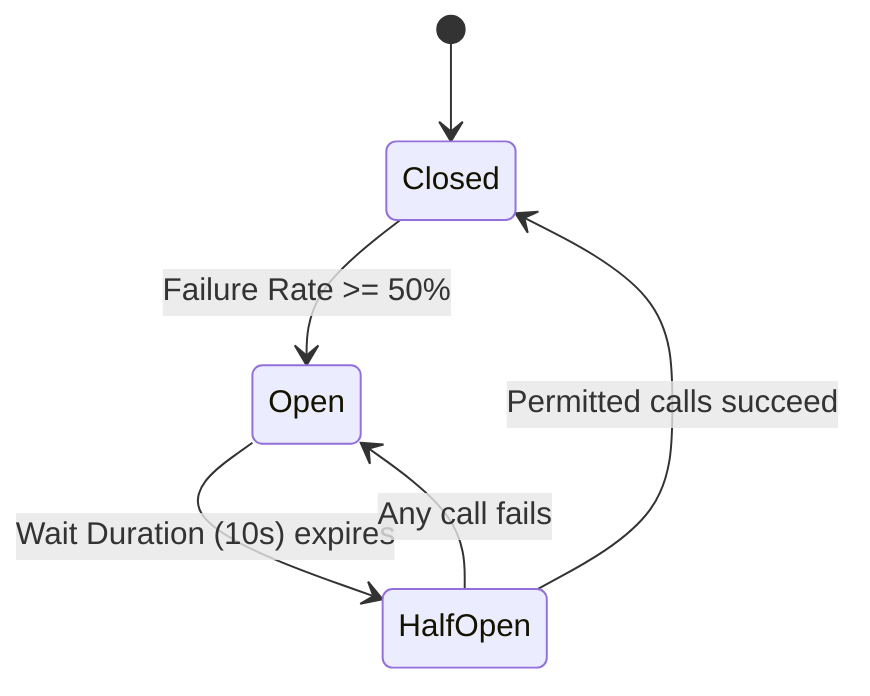
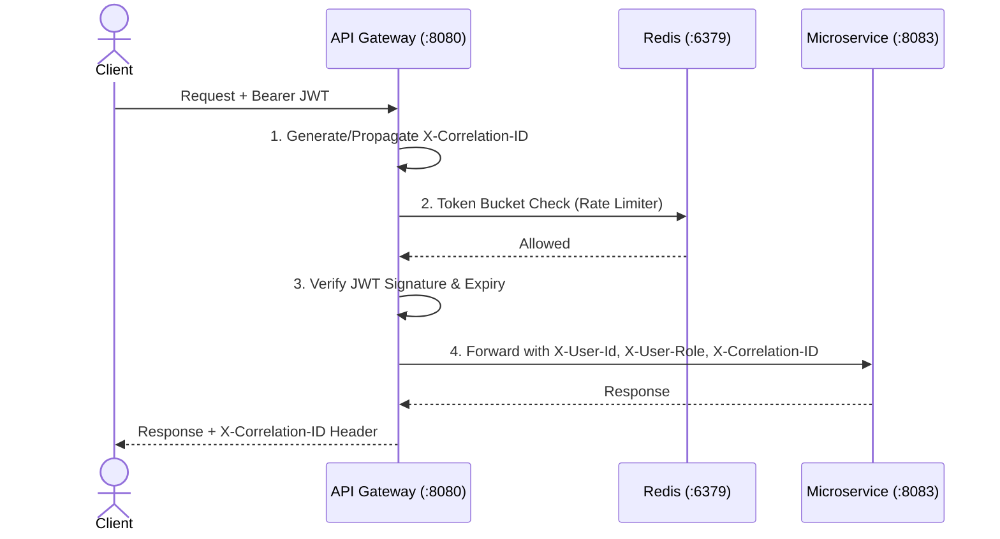

# Enterprise Spring Boot Microservices: Advanced Features Playbook
### *From Basic CRUD to Senior Distributed Architecture*

This playbook is a portable, production-grade implementation guide. It explains the **core mental models, prerequisites, code blueprints, and architecture traps** for implementing 6 advanced microservice capabilities in **any** Spring Boot project:

1. [High-Performance Pagination (Offset vs. Keyset vs. Cursor)](#1-high-performance-pagination)
2. [Stateless Security & JWT Token Generation](#2-stateless-security--jwt-token-generation)
3. [Inter-Service Communication & Resilience (OpenFeign + Circuit Breakers)](#3-inter-service-communication--resilience)
4. [Enterprise Soft Delete & Restoration Lifecycle](#4-enterprise-soft-delete--restoration-lifecycle)
5. [API Gateway Architecture (Routing, Tracing, Rate Limiting & Edge Auth)](#5-api-gateway-architecture)
6. [Senior Developer Architectural Decision Framework](#6-senior-developer-architectural-decision-framework)

---

## 1. High-Performance Pagination

### The Mental Model: Why Basic `LIMIT / OFFSET` Fails at Scale
When you use traditional offset pagination:
```sql
SELECT * FROM orders ORDER BY id DESC LIMIT 10 OFFSET 100000;
```
1. **The $O(N)$ Problem:** The MySQL InnoDB storage engine cannot magically jump to row 100,000. It must traverse the B-Tree index, load 100,010 row pointers, discard the first 100,000, and return the remaining 10. Database CPU and I/O grow linearly with page depth.
2. **The "Data Drift" Problem:** If 2 new orders are placed while a user views Page 1, all records shift down by 2. When the user clicks Page 2 (`OFFSET 10`), they see the last 2 items from Page 1 repeated!
3. **The `COUNT(*)` Bottleneck:** `Page<T>` forces an expensive table-scan count query on every request.

### The Solution: 3 Pagination Strategies

```mermaid
flowchart TD
    subgraph Offset["1. Offset-Based (LIMIT :size OFFSET :offset)"]
        O1["Client: page=5, size=10"] --> O2["DB scans 60 rows, discards 50"]
        O2 --> O3["Executes COUNT(*) query"]
        O3 --> O4["Best for: Admin tables with page jump buttons"]
    end

    subgraph Keyset["2. Keyset / Seek-Based (WHERE id < :lastSeenId)"]
        K1["Client: lastSeenId=500, size=10"] --> K2["B-Tree binary search directly to id=500"]
        K2 --> K3["Reads exactly size+1 (11) rows in O(1) time"]
        K3 --> K4["Best for: High-throughput APIs, deep data exports"]
    end

    subgraph Cursor["3. Cursor-Based (Opaque Base64 Tokens)"]
        C1["Client: cursor='NTAw', size=10"] --> C2["Server decodes 'NTAw' -> id=500"]
        C2 --> C3["Executes Keyset query; encodes last item -> nextCursor"]
        C3 --> C4["Best for: Public APIs (Stripe, GitHub), Mobile Infinite Scroll"]
    end
```



---

### How to Implement in Any Project

#### Step 1: Add Dependency
```xml
<dependency>
    <groupId>org.springframework.boot</groupId>
    <artifactId>spring-boot-starter-data-jpa</artifactId>
</dependency>
```

#### Step 2: Keyset Queries in Repository
In your Spring Data JPA repository, use indexed seek methods:
```java
public interface OrderRepository extends JpaRepository<OrderMaster, Long> {

    // First page seek
    List<OrderMaster> findAllByOrderByIdDesc(Pageable pageable);

    // Subsequent pages seek using B-Tree index
    List<OrderMaster> findByIdLessThanOrderByIdDesc(Long lastSeenId, Pageable pageable);
}
```

#### Step 3: The `size + 1` Lookahead Pattern in Service
To detect `hasNext` without running an expensive `COUNT(*)` query:
```java
@Transactional(readOnly = true)
public KeysetPageResponse<OrderResponseDto> getOrdersKeyset(Long lastSeenId, int size) {
    int safeSize = Math.min(Math.max(size, 1), 100);
    
    // Lookahead: Request size + 1 records
    Pageable pageable = PageRequest.of(0, safeSize + 1);

    List<OrderMaster> orders = (lastSeenId == null)
            ? new ArrayList<>(orderRepository.findAllByOrderByIdDesc(pageable))
            : new ArrayList<>(orderRepository.findByIdLessThanOrderByIdDesc(lastSeenId, pageable));

    boolean hasNext = orders.size() > safeSize;
    if (hasNext) {
        orders = orders.subList(0, safeSize); // Trim the extra lookahead item
    }

    Long nextLastSeenId = orders.isEmpty() ? null : orders.get(orders.size() - 1).getId();

    return KeysetPageResponse.<OrderResponseDto>builder()
            .data(orders.stream().map(this::mapToDto).toList())
            .lastSeenId(nextLastSeenId)
            .hasNext(hasNext)
            .build();
}
```

#### Step 4: Tokenizing for Cursor-Based Pagination
Create a URL-safe Base64 encoder/decoder:
```java
public final class CursorUtil {
    public static String encode(Long id) {
        if (id == null) return null;
        return Base64.getUrlEncoder().withoutPadding().encodeToString(String.valueOf(id).getBytes(StandardCharsets.UTF_8));
    }

    public static Long decode(String cursor) {
        if (cursor == null || cursor.trim().isEmpty()) return null;
        try {
            byte[] bytes = Base64.getUrlDecoder().decode(cursor.trim());
            return Long.parseLong(new String(bytes, StandardCharsets.UTF_8));
        } catch (Exception ex) {
            throw new IllegalArgumentException("Invalid pagination cursor token: " + cursor);
        }
    }
}
```

---

## 2. Stateless Security & JWT Token Generation

### The Mental Model: Stateful vs. Stateless
- **Stateful (Monolith):** Server stores user session in RAM (`HttpSession`). If you scale to 5 servers, Server 2 doesn't know the user logged into Server 1 unless you configure complex sticky sessions or shared session clusters.
- **Stateless (Microservices):** Server stores **nothing** in RAM. The user presents a cryptographically signed JSON Web Token (JWT) on every request. Any microservice with the public/secret key can verify the user instantly.

### Architecture of a JWT
A JWT consists of 3 Base64URL parts separated by dots (`.`):
$$\text{JWT} = \text{Header} \cdot \text{Payload (Claims)} \cdot \text{Signature}$$
- **Header:** Algorithm (`HS256`, `RS256`).
- **Payload:** User claims (`sub: "alice"`, `userId: 101`, `role: "ROLE_ADMIN"`, `exp: 1731000000`).
- **Signature:** $\text{HMACSHA256}(\text{Header} + "." + \text{Payload}, \text{SecretKey})$. If a malicious user changes their role from `ROLE_USER` to `ROLE_ADMIN`, the signature verification fails immediately!

---

### How to Implement in Any Project

#### Step 1: Dependencies
```xml
<dependency>
    <groupId>org.springframework.boot</groupId>
    <artifactId>spring-boot-starter-security</artifactId>
</dependency>
<!-- JJWT 0.11.5 -->
<dependency>
    <groupId>io.jsonwebtoken</groupId>
    <artifactId>jjwt-api</artifactId>
    <version>0.11.5</version>
</dependency>
<dependency>
    <groupId>io.jsonwebtoken</groupId>
    <artifactId>jjwt-impl</artifactId>
    <version>0.11.5</version>
    <scope>runtime</scope>
</dependency>
<dependency>
    <groupId>io.jsonwebtoken</groupId>
    <artifactId>jjwt-jackson</artifactId>
    <version>0.11.5</version>
    <scope>runtime</scope>
</dependency>
```

#### Step 2: Spring Security 6 Configuration (`SecurityConfig.java`)
```java
@Configuration
@EnableWebSecurity
public class SecurityConfig {

    @Bean
    public SecurityFilterChain filterChain(HttpSecurity http) throws Exception {
        http
            .csrf(AbstractHttpConfigurer::disable) // Disable CSRF for stateless REST APIs
            .sessionManagement(session -> session.sessionCreationPolicy(SessionCreationPolicy.STATELESS))
            .authorizeHttpRequests(auth -> auth
                .requestMatchers("/api/v1/auth/**").permitAll() // Public auth endpoints
                .requestMatchers(HttpMethod.GET, "/api/v1/products/**").permitAll()
                .anyRequest().authenticated()
            );
        return http.build();
    }

    @Bean
    public PasswordEncoder passwordEncoder() {
        return new BCryptPasswordEncoder(10); // Minimum 10 salt rounds
    }
}
```

#### Step 3: JWT Generator & Validator (`JwtUtil.java`)
```java
@Component
public class JwtUtil {

    @Value("${jwt.secret:defaultSecretKeyThatIsAtLeast32BytesLongForHS256Security!}")
    private String secret;

    private final long expirationMs = 86_400_000; // 24 hours

    private Key getSigningKey() {
        return Keys.hmacShaKeyFor(secret.getBytes(StandardCharsets.UTF_8));
    }

    public String generateToken(Long userId, String username, String role) {
        Map<String, Object> claims = new HashMap<>();
        claims.put("userId", userId);
        claims.put("role", role);

        return Jwts.builder()
                .setClaims(claims)
                .setSubject(username)
                .setIssuedAt(new Date())
                .setExpiration(new Date(System.currentTimeMillis() + expirationMs))
                .signWith(getSigningKey(), SignatureAlgorithm.HS256)
                .compact();
    }

    public Claims extractAllClaims(String token) {
        return Jwts.parserBuilder()
                .setSigningKey(getSigningKey())
                .build()
                .parseClaimsJws(token)
                .getBody();
    }
}
```

---

## 3. Inter-Service Communication & Resilience

### The Mental Model: Why Raw REST Calls Crash Systems
When `order-service` calls `product-service`:
1. **Dynamic Addressing:** IP addresses in containers and Kubernetes are ephemeral. Hardcoding `http://192.168.1.5:8082` will break when the container restarts. We need **Service Discovery (Eureka)** to resolve `http://product-service`.
2. **Context Loss (The Hop Problem):** The client sends a JWT to `order-service`. When `order-service` calls `product-service`, the HTTP request is brand new! Without a **Feign RequestInterceptor**, the authorization header is dropped, causing a `401 Unauthorized`.
3. **Cascading Failure (Thread Starvation):** If `product-service` experiences high latency (taking 15s per response), all incoming requests to `order-service` hang, consuming Tomcat's thread pool (typically 200 threads). Within seconds, `order-service` exhausts its threads and crashes, bringing down the entire platform.

### The Solution: OpenFeign + Resilience4j Circuit Breaker



---

### How to Implement in Any Project

#### Step 1: Dependencies
```xml
<dependency>
    <groupId>org.springframework.cloud</groupId>
    <artifactId>spring-cloud-starter-openfeign</artifactId>
</dependency>
<dependency>
    <groupId>org.springframework.cloud</groupId>
    <artifactId>spring-cloud-starter-circuitbreaker-resilience4j</artifactId>
</dependency>
<dependency>
    <groupId>org.springframework.boot</groupId>
    <artifactId>spring-boot-starter-aop</artifactId>
</dependency>
```

#### Step 2: Declarative Feign Client
```java
@FeignClient(name = "product-service", configuration = FeignClientConfig.class)
public interface ProductClient {
    @GetMapping("/api/v1/products/{id}")
    ProductResponseDto getProductById(@PathVariable("id") Long id);
}
```

#### Step 3: Forwarding JWT via RequestInterceptor
```java
@Configuration
public class FeignClientConfig {

    @Bean
    public RequestInterceptor bearerTokenRequestInterceptor() {
        return requestTemplate -> {
            ServletRequestAttributes attributes = 
                (ServletRequestAttributes) RequestContextHolder.getRequestAttributes();
            if (attributes != null) {
                String authHeader = attributes.getRequest().getHeader(HttpHeaders.AUTHORIZATION);
                if (authHeader != null && authHeader.startsWith("Bearer ")) {
                    requestTemplate.header(HttpHeaders.AUTHORIZATION, authHeader);
                }
            }
        };
    }
}
```

#### Step 4: Circuit Breaker with Fallback
```java
@Service
@RequiredArgsConstructor
public class OrderService {

    private final ProductClient productClient;
    private final OrderRepository orderRepository;

    @Transactional
    @CircuitBreaker(name = "productService", fallbackMethod = "createOrderFallback")
    public OrderResponseDto createOrder(OrderRequestDto request) {
        // Feign call: protected by circuit breaker
        ProductResponseDto product = productClient.getProductById(request.getProductId());
        
        // Business logic...
        return mapToResponseDto(orderRepository.save(order));
    }

    // Fallback executed if Product Service is DOWN, times out, or throws 5xx
    public OrderResponseDto createOrderFallback(OrderRequestDto request, Throwable throwable) {
        log.error("Circuit breaker opened for product {}. Reason: {}", request.getProductId(), throwable.getMessage());
        OrderMaster failedOrder = OrderMaster.builder()
                .userId(request.getUserId())
                .orderStatus(OrderStatus.FAILED)
                .failureReason("Product Service unreachable: " + throwable.getMessage())
                .build();
        return mapToResponseDto(orderRepository.save(failedOrder));
    }
}
```

---

## 4. Enterprise Soft Delete & Restoration Lifecycle

### The Mental Model: Why Hard Deletes Are Prohibited
In enterprise production, `DELETE FROM table WHERE id = ?` causes severe issues:
1. **Destroys Audit Compliance:** Accounting regulations (SOX, PCI-DSS) legally mandate retaining order transaction logs for years.
2. **Breaks Foreign Keys:** Hard-deleting an order cascades to shipments, payments, and invoices, wiping related records.
3. **No Recovery:** Accidental user deletions cannot be reversed without costly database backup restoration.

### The Modern Solution: Hibernate 6 `@SQLDelete` + `@SQLRestriction`
- Legacy Hibernate used `@Where(clause = "deleted = false")`, which is **deprecated** in Hibernate 6.
- The modern standard is `@SQLRestriction("deleted = false")`.

---

### How to Implement in Any Project

#### Step 1: Entity Configuration (`OrderMaster.java`)
```java
@Entity
@Table(name = "order_master")
// 1. Intercept entity removal and execute UPDATE instead
@SQLDelete(sql = "UPDATE order_master SET deleted = true, deleted_at = CURRENT_TIMESTAMP WHERE id = ?")
// 2. Automatically append 'AND (deleted = false)' to all SELECT queries
@SQLRestriction("deleted = false")
@Data
public class OrderMaster {

    @Id
    @GeneratedValue(strategy = GenerationType.IDENTITY)
    private Long id;

    @Builder.Default
    @Column(nullable = false)
    private Boolean deleted = false;

    private Instant deletedAt;
}
```

#### Step 2: Bypassing the Filter for Admin & Restore (`OrderRepository.java`)
Because `@SQLRestriction` automatically filters out deleted records, standard JPA methods like `findById` return `Optional.empty()` for deleted items.  
**Use native SQL to bypass Hibernate's AST parser:**

```java
public interface OrderRepository extends JpaRepository<OrderMaster, Long> {

    // Native query bypasses @SQLRestriction
    @Query(value = "SELECT * FROM order_master WHERE id = :id", nativeQuery = true)
    Optional<OrderMaster> findByIdIncludingDeleted(@Param("id") Long id);

    @Query(value = "SELECT * FROM order_master WHERE deleted = true ORDER BY deleted_at DESC", nativeQuery = true)
    List<OrderMaster> findAllDeletedOrders();

    @Modifying
    @Query(value = "UPDATE order_master SET deleted = false, deleted_at = NULL WHERE id = :id", nativeQuery = true)
    int restoreOrderById(@Param("id") Long id);
}
```

#### Senior Gotcha: The Unique Constraint Trap
> [!WARNING]
> If a table has a `UNIQUE(order_code)` constraint, soft-deleting `ORD-101` prevents users from creating a new order with `ORD-101` in the future!  
> **Solution:** Create a composite unique index with `deleted_at`:  
> `UNIQUE KEY uq_order_deleted (order_code, deleted_at)`  
> In MySQL and PostgreSQL, `NULL != NULL`, so multiple active orders can coexist with `deleted_at = NULL` while allowing uniqueness per deletion timestamp.

---

## 5. API Gateway Architecture

### The Mental Model: The Perimeter Security Pattern
Instead of every microservice verifying JWTs, parsing headers, and managing SSL certificates:
1. **API Gateway (Spring Cloud Gateway WebFlux):** Operates on high-throughput non-blocking Netty.
2. The Gateway authenticates the request once at the edge.
3. The Gateway extracts claims and **decorates downstream headers**:
   - `X-User-Id: 101`
   - `X-User-Role: ROLE_USER`
   - `X-Correlation-ID: 7a8b9c...`
4. Downstream microservices run in a private network, trusting these pre-verified headers without running heavy crypto/JWT verification!



---

### How to Implement in Any Project

#### Step 1: Dependencies
```xml
<dependency>
    <groupId>org.springframework.cloud</groupId>
    <artifactId>spring-cloud-starter-gateway</artifactId>
</dependency>
<dependency>
    <groupId>org.springframework.boot</groupId>
    <artifactId>spring-boot-starter-data-redis-reactive</artifactId>
</dependency>
<dependency>
    <groupId>org.springframework.cloud</groupId>
    <artifactId>spring-cloud-starter-netflix-eureka-client</artifactId>
</dependency>
```

#### Step 2: Distributed Tracing Filter (`CorrelationIdGlobalFilter.java`)
```java
@Component
public class CorrelationIdGlobalFilter implements GlobalFilter, Ordered {

    public static final String CORRELATION_ID_HEADER = "X-Correlation-ID";

    @Override
    public Mono<Void> filter(ServerWebExchange exchange, GatewayFilterChain chain) {
        String correlationId = exchange.getRequest().getHeaders().getFirst(CORRELATION_ID_HEADER);
        if (correlationId == null || correlationId.isBlank()) {
            correlationId = UUID.randomUUID().toString();
        }

        // Mutate request headers downstream
        ServerHttpRequest mutatedRequest = exchange.getRequest().mutate()
                .header(CORRELATION_ID_HEADER, correlationId)
                .build();

        // Mutate response header to return to caller
        exchange.getResponse().getHeaders().add(CORRELATION_ID_HEADER, correlationId);

        return chain.filter(exchange.mutate().request(mutatedRequest).build());
    }

    @Override
    public int getOrder() {
        return Ordered.HIGHEST_PRECEDENCE; // Must execute first
    }
}
```

#### Step 3: Edge JWT Validation & Claim Decoration (`JwtValidationFilter.java`)
```java
@Component
public class JwtValidationFilter extends AbstractGatewayFilterFactory<JwtValidationFilter.Config> {

    @Autowired
    private JwtUtil jwtUtil;

    @Override
    public GatewayFilter apply(Config config) {
        return (exchange, chain) -> {
            ServerHttpRequest request = exchange.getRequest();
            String path = request.getURI().getPath();

            // Whitelist public paths
            if (path.startsWith("/api/v1/auth/")) {
                return chain.filter(exchange);
            }

            String authHeader = request.getHeaders().getFirst(HttpHeaders.AUTHORIZATION);
            if (authHeader == null || !authHeader.startsWith("Bearer ")) {
                return onError(exchange, HttpStatus.UNAUTHORIZED);
            }

            String token = authHeader.substring(7);
            try {
                Claims claims = jwtUtil.extractAllClaims(token);
                // Decorate downstream headers
                ServerHttpRequest mutatedRequest = request.mutate()
                        .header("X-User-Id", String.valueOf(claims.get("userId")))
                        .header("X-User-Role", String.valueOf(claims.get("role")))
                        .build();

                return chain.filter(exchange.mutate().request(mutatedRequest).build());
            } catch (Exception e) {
                return onError(exchange, HttpStatus.UNAUTHORIZED);
            }
        };
    }

    private Mono<Void> onError(ServerWebExchange exchange, HttpStatus status) {
        exchange.getResponse().setStatusCode(status);
        return exchange.getResponse().setComplete();
    }
}
```

#### Step 4: Redis Token Bucket Rate Limiting (`RateLimiterConfig.java`)
```java
@Configuration
public class RateLimiterConfig {

    @Bean
    public KeyResolver userKeyResolver() {
        // Resolve rate limit key by User-Id or Client IP
        return exchange -> {
            String userId = exchange.getRequest().getHeaders().getFirst("X-User-Id");
            if (userId != null) {
                return Mono.just(userId);
            }
            return Mono.just(Objects.requireNonNull(exchange.getRequest().getRemoteAddress()).getAddress().getHostAddress());
        };
    }
}
```

Configure in `application.yml`:
```yaml
spring:
  cloud:
    gateway:
      routes:
        - id: order-service-route
          uri: lb://order-service
          predicates:
            - Path=/api/v1/orders/**
          filters:
            - name: RequestRateLimiter
              args:
                redis-rate-limiter.replenishRate: 10 # 10 requests allowed per second
                redis-rate-limiter.burstCapacity: 20 # Maximum burst of 20
                key-resolver: "#{@userKeyResolver}"
```

---

## 6. Senior Developer Architectural Decision Framework

When designing systems, use this checklist to justify architectural choices in design reviews and interviews:

| System Requirement | Junior Choice | Senior Decision & Rationale |
| :--- | :--- | :--- |
| **Paging Large Datasets** | `Pageable` with `OFFSET` | **Keyset / Cursor Pagination** with $O(1)$ B-Tree seek to prevent table scans and data drift. |
| **Deleting Orders** | `DELETE FROM` | **Soft Delete** via `@SQLDelete` & `@SQLRestriction` to preserve audit trails and foreign key integrity. |
| **Downstream Call Latency** | Direct HTTP call | **Resilience4j Circuit Breaker** with degraded fallback to prevent thread starvation. |
| **Passing Security Context** | Re-parsing JWT in every service | **Perimeter Authentication at Gateway**; forward lightweight pre-validated `X-User-Id` headers. |
| **Debugging Issues Across 5 Services** | Searching random log files | **Distributed Tracing** with `X-Correlation-ID` passed through all hops via Feign Interceptors and Gateway filters. |
| **Database Architecture** | 1 shared MySQL schema | **Database-per-Service Pattern** ensuring services can scale, deploy, and evolve their schemas independently. |

